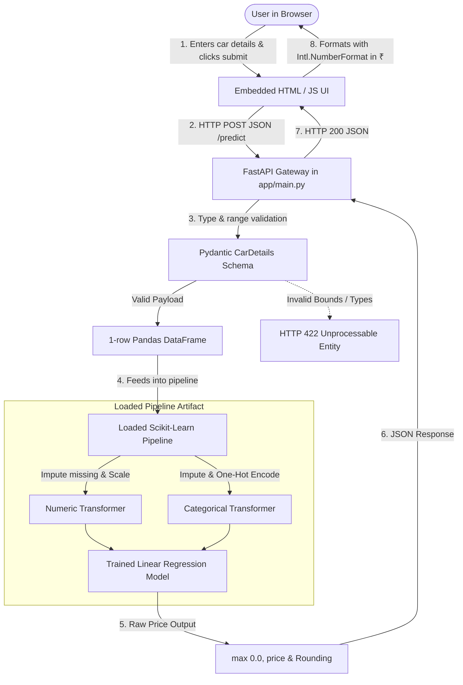
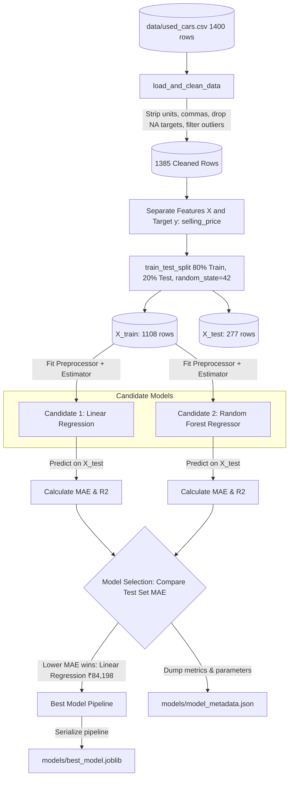
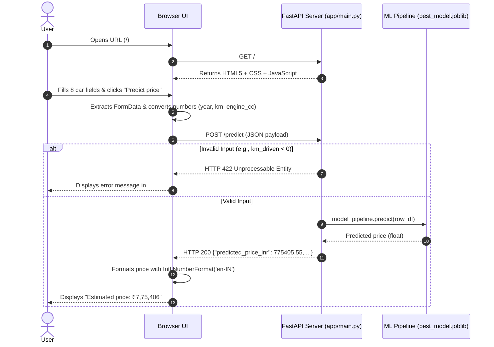

# Used Car Price Prediction: Complete Technical Interview Guide

> **Target Audience:** B.Tech Computer Science & Engineering freshers and junior developers preparing for technical interviews.  
> **Repository:** [em-srs/car_price_predictor](https://github.com/em-srs/car_price_predictor)  
> **Live Web Application:** [https://car-price-predictor-hkae.onrender.com/](https://car-price-predictor-hkae.onrender.com/)

---

## Table of Contents
1. [Project Overview & Elevator Pitch](#1-project-overview--elevator-pitch)
2. [Complete Project Structure](#2-complete-project-structure)
3. [Architecture Diagrams](#3-architecture-diagrams)
4. [Dataset Deep Dive](#4-dataset-deep-dive)
5. [Core Machine Learning Concepts](#5-core-machine-learning-concepts)
6. [Training Workflow: Line-by-Line Breakdown](#6-training-workflow-line-by-line-breakdown)
7. [API Endpoints & Request/Response Lifecycle](#7-api-endpoints--requestresponse-lifecycle)
8. [Frontend-to-Backend Execution Flow](#8-frontend-to-backend-execution-flow)
9. [Model Persistence & Deployment](#9-model-persistence--deployment)
10. [Testing, Debugging & Real Bug Fixes](#10-testing-debugging--real-bug-fixes)
11. [Project Limitations & Future Scope](#11-project-limitations--future-scope)
12. [Top 10 Interview Questions & Spoken Answers](#12-top-10-interview-questions--spoken-answers)
13. [Rapid Revision Cheat Sheet](#13-rapid-revision-cheat-sheet)

---

## 1. Project Overview & Elevator Pitch

### What the Project Does
The **Used Car Price Prediction** system is an end-to-end Machine Learning web application. A user inputs details about a used automobile (such as manufacturing year, mileage in kilometres, fuel type, transmission, ownership history, and engine capacity), and the system estimates its fair selling price in **Indian Rupees (₹ / INR)**.

### The Problem It Solves
Buying or selling a pre-owned vehicle is typically subjective and opaque. Buyers risk overpaying, while sellers struggle to establish competitive listing prices. This application demonstrates an automated data-driven approach to estimating fair valuations using regression analysis on historical car attributes.

### Why Predicting Used-Car Prices is a Regression Problem
- In machine learning, **Classification** predicts discrete category labels (e.g., "Spam vs Not Spam", "Fraud vs Legitimate").
- **Regression** predicts a **continuous numerical quantity** on a continuous scale. Because car price is an uninterrupted monetary value (e.g., ₹7,75,405.55 or ₹9,10,948.00) rather than a fixed bucket, it is modeled mathematically as a regression task.

### Input Features & Predicted Output
- **Input Features (8 total):**
  - **Numerical:** `year` (manufacturing year), `km_driven` (distance travelled), `engine_cc` (engine displacement in cubic centimetres).
  - **Categorical:** `make` (brand/manufacturer), `model` (vehicle model name), `fuel` (Petrol, Diesel, CNG, Electric), `transmission` (Manual, Automatic), `owner` (First, Second, Third, Fourth+).
- **Predicted Output:** `predicted_price_inr` (continuous numerical value in INR).

### Who Could Use Such an Application?
- Individual car buyers and private sellers wanting a baseline valuation before negotiations.
- Used car dealership portals and vehicle trading platforms to automate instant listing estimates.

### Technology Stack & Role of Each Tool
| Technology | Role in Project | Why It Was Chosen |
| :--- | :--- | :--- |
| **Python 3.13** | Core Programming Language | Rich data science ecosystem, standard for modern AI/ML. |
| **Pandas** | Data Wrangling & Manipulation | Efficient tabular data handling, cleaning strings, filtering invalid rows. |
| **NumPy** | Numerical Operations | Fast mathematical arrays and handling NaN / missing value structures. |
| **Scikit-Learn** | Machine Learning Pipeline | Preprocessing (`ColumnTransformer`, `OneHotEncoder`, `SimpleImputer`) and training models (`LinearRegression`, `RandomForestRegressor`). |
| **Joblib** | Model Serialization | Saves the entire scikit-learn preprocessing-plus-model pipeline to a single `.joblib` file. |
| **FastAPI** | Backend Web Framework | High-performance asynchronous REST API with automatic Pydantic request validation and interactive Swagger docs. |
| **Uvicorn** | ASGI Web Server | Production-ready server that serves the FastAPI application. |
| **Pydantic** | Schema Validation | Validates incoming JSON types, ranges, and constraints at the API gateway before reaching the model. |
| **HTML5 / CSS / Vanilla JS** | Web Interface | Lightweight, embedded frontend with zero external dependencies, providing real-time INR currency formatting. |
| **Pytest & HTTPX** | Automated Testing | Comprehensive test suite validating API status codes, input validation bounds, and model predictions. |
| **Render** | Cloud Platform (PaaS) | Deploys the application and runs automated build/training commands from GitHub. |

---

### 45–60 Second Elevator Pitch (Memorize This!)

> *"I built an end-to-end Used Car Price Prediction web application that estimates the fair market value of used cars in Indian Rupees. The pipeline cleans tabular data with pandas, handles missing values and text-formatted numbers, and trains both Linear Regression and Random Forest models using a scikit-learn pipeline. After evaluating both models on an unseen test set using Mean Absolute Error and R-squared, the lower-MAE model is serialized using Joblib.*  
>  
> *I then built a production-ready FastAPI backend that validates user inputs with Pydantic, passes them through the saved pipeline, and returns the predicted price in INR. The app also features an embedded interactive web UI and full automated test coverage with Pytest, deployed live on Render."*

---

## 2. Complete Project Structure

```text
used-car-price-prediction/
├── app/
│   ├── __init__.py           # Python package marker for the app module
│   └── main.py               # FastAPI application, Pydantic schemas, endpoints & HTML UI
├── data/
│   ├── README.md             # Dataset documentation and synthetic data disclaimer
│   └── used_cars.csv         # Tabular training dataset (1,400 raw rows)
├── models/
│   ├── .gitkeep              # Keeps the directory tracked in Git
│   ├── best_model.joblib     # [Generated Artifact] Serialized scikit-learn pipeline
│   └── model_metadata.json   # [Generated Artifact] Evaluation metrics, features, & selected model
├── tests/
│   └── test_api.py           # 12 automated unit and integration tests using Pytest & TestClient
├── .gitignore                # Excludes virtualenv, cached files, and heavy model binaries from Git
├── README.md                 # Project guide, quickstart instructions, and live deployment link
├── render.yaml               # Cloud deployment specification for Render web service
├── requirements.txt          # Pinned Python package dependencies
└── train.py                  # Standalone ML training script for cleaning, modeling, and evaluation
```

### File Classification
- **Source Code Files:** `app/main.py`, `train.py`, `tests/test_api.py`.
- **Data Files:** `data/used_cars.csv`, `data/README.md`.
- **Generated Artifacts (created by `python train.py`):** `models/best_model.joblib`, `models/model_metadata.json`.
- **Infrastructure & Configuration:** `render.yaml`, `requirements.txt`, `.gitignore`, `README.md`.

---

## 3. Architecture Diagrams

### A. Inference Pipeline (User Request to Price Display)



### B. Machine Learning Training Workflow (`train.py`)



---

## 4. Dataset Deep Dive

### Dataset Attributes
- **Raw File:** `data/used_cars.csv`
- **Total Rows:** 1,400 raw rows.
- **Total Columns:** 9 (8 input features + 1 target variable).
- **Target Variable:** `selling_price` (selling price in Indian Rupees ₹).
- **Nature of the Data:** Synthetic, reproducible dataset created specifically to demonstrate data cleaning and end-to-end ML deployment. *(Interview Tip: Never claim it is verified commercial dealership data).*

### Feature Dictionary Table

| Column Name | Meaning / Description | Data Type | Machine Learning Role | Example Value |
| :--- | :--- | :--- | :--- | :--- |
| `make` | Manufacturer or brand of the car | Categorical (string) | Input Feature ($X$) | `"Maruti"`, `"Hyundai"` |
| `model` | Specific vehicle model name | Categorical (string) | Input Feature ($X$) | `"Swift"`, `"Creta"` |
| `year` | Manufacturing / model year | Numerical (integer) | Input Feature ($X$) | `2021` |
| `km_driven` | Total kilometres the car has been driven | Numerical (float/int) | Input Feature ($X$) | `35000` |
| `fuel` | Fuel engine type | Categorical (string) | Input Feature ($X$) | `"Petrol"`, `"Diesel"`, `"CNG"`, `"Electric"` |
| `transmission` | Transmission gear mechanism | Categorical (string) | Input Feature ($X$) | `"Manual"`, `"Automatic"` |
| `owner` | Ownership sequence category | Categorical (string) | Input Feature ($X$) | `"First"`, `"Second"`, `"Third"`, `"Fourth+"` |
| `engine_cc` | Engine displacement capacity | Numerical (float/int) | Input Feature ($X$) | `1200.0` |
| **`selling_price`** | **Final agreed selling price in INR** | **Numerical (float/int)** | **Target Variable ($y$)** | **`750000`** |

### Data Cleaning Operations Performed by `train.py`
In real-world data, numbers often contain commas (e.g., `"35,000"`) or unit suffixes (e.g., `"1200 cc"`).
1. **Cleaning Numeric Text:** The custom helper `clean_numeric()` uses regular expressions to strip commas and non-numeric characters, casting values safely using `pd.to_numeric(errors="coerce")`.
2. **Dropping Missing Targets:** Any row missing the `selling_price` is dropped (`df.dropna(subset=[TARGET])`) because we cannot train supervised learning models without ground truth labels.
3. **Plausibility & Outlier Filtering:**
   - `selling_price` must lie between `0` and `20,000,000` (₹2 Crore).
   - `year` must lie between `1980` and `2026`.
   - `km_driven` must lie between `0` and `1,000,000` km.
   *(Result: 1,385 valid rows remain; 15 corrupted/outlier rows were safely filtered).*
4. **Categorical Normalization:** Cleans white spaces and replaces empty strings or `"nan"` strings with true `np.nan` values so scikit-learn imputers can process them properly.

---

## 5. Core Machine Learning Concepts

### 1. Regression vs Classification
- **Classification:** Identifies which discrete class or category a sample belongs to (e.g., binary: buy/don't buy; multiclass: compact, sedan, SUV).
- **Regression:** Predicts a continuous, unbounded numerical quantity. Because car price is a scalar monetary value, this project uses regression.

### 2. Features ($X$) and Target ($y$)
- $X$ represents the independent variables: the characteristics of the car.
- $y$ represents the dependent variable: the selling price we want to predict based on $X$.

### 3. Why Train/Test Split is Crucial
If we evaluate a model on the same data it learned from, it can simply memorize the training examples (overfitting). We split the dataset into:
- **Training Set (80% / 1,108 rows):** The model learns coefficients and split criteria only from this subset.
- **Testing Set (20% / 277 rows):** Held out completely until training is done to simulate how the model generalizes to brand-new, unseen cars.
- `random_state=42` ensures that the split is strictly reproducible across runs.

### 4. The Scikit-Learn Preprocessing Pipeline & Avoiding Data Leakage
- **Median Imputation (`SimpleImputer(strategy="median")`):** Fills missing numerical values with the median of the column. Median is preferred over mean because it is robust against extreme outliers.
- **Most-Frequent Imputation (`SimpleImputer(strategy="most_frequent")`):** Fills missing categorical values with the mode (most common category).
- **One-Hot Encoding (`OneHotEncoder(handle_unknown="ignore")`):** Converts string categories into binary indicator columns (0s and 1s). Setting `handle_unknown="ignore"` ensures that if a user in production provides a brand or model never seen during training, the pipeline encodes it as all zeros rather than crashing with an exception.
- **What is Data Leakage?** If you calculate the mean, median, or one-hot categories on the entire dataset *before* splitting, information from the test set leaks into the training phase. By combining preprocessing and the model into a unified `Pipeline`, preprocessing is fitted strictly on `X_train` during `pipeline.fit()`.

### 5. Linear Regression vs Random Forest Regressor

| Aspect | Linear Regression | Random Forest Regressor |
| :--- | :--- | :--- |
| **Underlying Idea** | Finds the best-fit hyperplane by minimizing the sum of squared residuals: $y = \beta_0 + \sum \beta_i x_i$. | An ensemble of hundreds of decision trees (`n_estimators=180`) trained on random subsets of data and features. |
| **Pattern Recognition** | Captures linear relationships (e.g., higher mileage linearly reduces price). | Captures non-linear relationships and complex feature interactions. |
| **Strengths** | Fast to train, highly interpretable, compact model size, cannot overfit easily on simple distributions. | Highly flexible, robust to outliers, models complex non-linear curves. |
| **Weaknesses** | Cannot naturally model complex non-linear curves without manual feature engineering. | Larger file size, slower inference, risk of overfitting if leaf sizes are not constrained. |

### 6. Model Evaluation Metrics

#### A. Mean Absolute Error (MAE)
$$\text{MAE} = \frac{1}{n} \sum_{i=1}^{n} |y_i - \hat{y}_i|$$
- **What it means:** The average absolute difference between the predicted car price and the actual selling price, expressed directly in Indian Rupees (₹).
- **Interpretation:** **Lower is better.** An MAE of ₹84,198 means the model's prediction is off by approximately ₹84,198 on average.

#### B. Coefficient of Determination ($R^2$ Score)
$$R^2 = 1 - \frac{\sum (y_i - \hat{y}_i)^2}{\sum (y_i - \bar{y})^2}$$
- **What it means:** The proportion of variance in car prices explained by the features compared to a baseline horizontal line (the mean car price).
- **Interpretation:** Closer to `1.0` is better; an $R^2$ of `0.8079` means the model explains ~80.8% of the price variation in the test data.

### Actual Measured Training Results
From the actual training run stored in [`models/model_metadata.json`](file:///d:/CODINGBRO/used-car-price-prediction/models/model_metadata.json):

| Candidate Model | Measured Test MAE (INR) | Measured Test $R^2$ Score | Selection Outcome |
| :--- | :---: | :---: | :---: |
| **Linear Regression** | **₹84,198.24** | **0.8079** | **SELECTED (Winner)** |
| **Random Forest Regressor** | ₹91,965.21 | 0.7628 | Rejected |

**Model Selection Rule:** In `train.py`, model selection is strictly automated based on lower test set MAE:
```python
best_name = min(results, key=lambda name: results[name]["mae_inr"])
```
Linear Regression achieved an MAE ~₹7,767 lower than Random Forest on the held-out test set, making it the selected production model.

---

## 6. Training Workflow: Line-by-Line Breakdown

The training script [`train.py`](file:///d:/CODINGBRO/used-car-price-prediction/train.py) executes in the following sequence:

### Step 1: Handling Windows Standard Output Encoding
```python
import sys
if hasattr(sys.stdout, "reconfigure"):
    sys.stdout.reconfigure(encoding="utf-8")
```
*Purpose:* Prevents `UnicodeEncodeError` crashes on Windows command lines when printing Unicode symbols like the Rupee symbol (`₹`) or superscripts ($R^2$).

### Step 2: Loading & Cleaning Tabular Data
```python
def load_and_clean_data(path: Path = DATA_PATH) -> pd.DataFrame:
    df = pd.read_csv(path)
    for col in ["year", "km_driven", "engine_cc", TARGET]:
        df[col] = clean_numeric(df[col])
    df = df.dropna(subset=[TARGET])
    df = df[df[TARGET].between(0, 20_000_000)]
    df = df[df["year"].between(1980, 2026)]
    df = df[df["km_driven"].between(0, 1_000_000)]
    ...
```
*Purpose:* Strips non-numeric characters, drops unlabelled rows, and removes implausible outliers.

### Step 3: Preprocessing Pipeline Construction
```python
def build_pipeline(model):
    numeric_pipe = Pipeline([
        ("imputer", SimpleImputer(strategy="median")),
    ])
    categorical_pipe = Pipeline([
        ("imputer", SimpleImputer(strategy="most_frequent")),
        ("onehot", OneHotEncoder(handle_unknown="ignore")),
    ])
    preprocessor = ColumnTransformer([
        ("numeric", numeric_pipe, NUMERIC_FEATURES),
        ("categorical", categorical_pipe, CATEGORICAL_FEATURES),
    ])
    return Pipeline([("preprocessor", preprocessor), ("model", model)])
```
*Purpose:* Bundles feature transformation and the ML algorithm into one composite object, ensuring zero data leakage and effortless production deployment.

### Step 4: Model Training, Evaluation & Comparison
```python
X_train, X_test, y_train, y_test = train_test_split(X, y, test_size=0.20, random_state=42)
for name, estimator in candidates.items():
    pipeline = build_pipeline(estimator)
    pipeline.fit(X_train, y_train)
    predictions = pipeline.predict(X_test)
    mae = float(mean_absolute_error(y_test, predictions))
    r2 = float(r2_score(y_test, predictions))
```
*Purpose:* Trains both estimators on `X_train`, predicts on `X_test`, and records MAE and $R^2$.

### Step 5: Artifact Serialization
```python
best_name = min(results, key=lambda name: results[name]["mae_inr"])
joblib.dump(trained[best_name], MODEL_DIR / "best_model.joblib")
(MODEL_DIR / "model_metadata.json").write_text(json.dumps(metadata, indent=2))
```
*Purpose:* Saves the winning pipeline to `best_model.joblib` and writes evaluation metrics to `model_metadata.json`.

---

## 7. API Endpoints & Request/Response Lifecycle

The backend in [`app/main.py`](file:///d:/CODINGBRO/used-car-price-prediction/app/main.py) is implemented using **FastAPI**.

### Endpoint Reference Table

| Method | Endpoint | Purpose | Response Format |
| :---: | :--- | :--- | :--- |
| `GET` | `/` | Serves the interactive HTML/JS prediction web page | `text/html; charset=utf-8` |
| `GET` | `/health` | Liveness and model loading status check | `application/json` |
| `GET` | `/model-info` | Returns evaluation metrics and model details | `application/json` |
| `POST`| `/predict` | Computes price prediction for given car details | `application/json` |
| `GET` | `/docs` | Interactive Swagger UI API documentation | `text/html` |

---

### Deep Dive: `POST /predict`

#### Sample Valid Request
```json
{
  "make": "Maruti",
  "model": "Swift",
  "year": 2021,
  "km_driven": 35000,
  "fuel": "Petrol",
  "transmission": "Manual",
  "owner": "First",
  "engine_cc": 1200
}
```

#### Sample Successful Response (`HTTP 200 OK`)
```json
{
  "predicted_price_inr": 775405.55,
  "currency": "INR",
  "note": "Estimated value from a learning dataset; not a verified market quote."
}
```

#### Pydantic Schema Validation Rules
FastAPI validates every incoming field using Pydantic:
```python
class CarDetails(BaseModel):
    make: str = Field(..., min_length=1)
    model: str = Field(..., min_length=1)
    year: int = Field(..., ge=1980, le=2026)
    km_driven: float = Field(..., ge=0, le=1_000_000)
    fuel: str = Field(..., min_length=1)
    transmission: str = Field(..., min_length=1)
    owner: str = Field(..., min_length=1)
    engine_cc: float = Field(..., gt=0, le=10000)
```

#### Validation Error Handling (`HTTP 422 Unprocessable Entity`)
If a client sends an invalid payload (e.g., negative mileage `"km_driven": -5000` or year outside range `"year": 1950`), FastAPI automatically intercepts the request before it reaches the model and responds with HTTP 422:
```json
{
  "detail": [
    {
      "type": "greater_than_equal",
      "loc": ["body", "km_driven"],
      "msg": "Input should be greater than or equal to 0",
      "input": -5000
    }
  ]
}
```

#### How Prediction Occurs Internally
1. The validated `CarDetails` object is converted into a dictionary via `car.model_dump()`.
2. A single-row Pandas DataFrame is created: `pd.DataFrame([car.model_dump()])`.
3. The saved Joblib pipeline transforms the row and predicts: `model_pipeline.predict(row)[0]`.
4. A safety non-negative check prevents negative valuations: `max(0.0, predicted_price)`.
5. The result is rounded to 2 decimal places and returned as JSON.

---

## 8. Frontend-to-Backend Execution Flow



### Architecture Clarification: Frontend Type
- The frontend is **server-delivered Vanilla HTML, CSS, and JavaScript**, embedded directly in `app/main.py`.
- It is **not** a separate React or Vue SPA. This keeps the project lightweight, dependency-free, and directly hosted from a single container or server.

---

## 9. Model Persistence & Deployment

### Why Save the Model with Joblib?
- Training takes several seconds and requires the dataset. In production, an API must respond within milliseconds (<50ms).
- **Joblib** serializes the entire scikit-learn pipeline (both the fitted transformers and the fitted estimator weights) to disk.
- When FastAPI starts, it loads the model into memory **once** via `joblib.load(MODEL_PATH)`, allowing instant predictions on incoming requests.

### What Happens if the Model File is Missing?
If `models/best_model.joblib` does not exist:
- The startup loader catches the missing file and sets `model_pipeline = None`.
- The `/health` endpoint reports `{"status": "ok", "model_loaded": false}`.
- If a user calls `/predict`, the API cleanly returns `HTTP 503 Service Unavailable` with the message: *"Model is not trained yet. Run python train.py."*

### Cloud Deployment on Render (`render.yaml`)
The project includes a declarative Render blueprint file:
```yaml
services:
  - type: web
    name: used-car-price-prediction
    runtime: python
    buildCommand: pip install -r requirements.txt && python train.py
    startCommand: uvicorn app.main:app --host 0.0.0.0 --port $PORT
    healthCheckPath: /health
```
- **`buildCommand`**: Runs upon every Git push. It installs dependencies and executes `python train.py` to generate fresh model artifacts on the cloud server.
- **`startCommand`**: Starts Uvicorn, binding to the dynamic `$PORT` provided by Render.
- **Live URL**: `https://car-price-predictor-hkae.onrender.com/`

---

## 10. Testing, Debugging & Real Bug Fixes

### Test Suite (`tests/test_api.py`)
The automated test suite contains **12 Pytest tests** verifying:
1. `/health` responds with `200 OK` and `model_loaded: true`.
2. `/model-info` returns model name and evaluation metrics.
3. `/` returns the HTML form containing all 8 car fields.
4. `/docs` loads the Swagger documentation.
5. `/predict` returns a non-negative float price for valid car details.
6. `/predict` supports alternative vehicle types (Diesel / Automatic).
7. `/predict` supports unknown categories (e.g., Make="Tesla") without crashing.
8. Validation tests reject negative mileage, years < 1980, future years > 2026, zero engine cc, and empty strings with `HTTP 422`.

All 12 tests run via:
```bash
python -m pytest -v
```

### Real Bugs Discovered & Fixed During Development
1. **Windows Encoding Crash (`UnicodeEncodeError`):**
   - *Problem:* Running `train.py` on Windows threw `UnicodeEncodeError: 'charmap' codec can't encode character '\u20b9'` when attempting to print the Indian Rupee symbol `₹`.
   - *Fix:* Added `sys.stdout.reconfigure(encoding="utf-8")` at the entry point of `train.py`.
2. **Missing CORS Headers for Cross-Origin Callers:**
   - *Problem:* If an external frontend called the API, browser security policies blocked the request.
   - *Fix:* Added `CORSMiddleware` in `app/main.py` allowing cross-origin requests.
3. **Empty Models Directory in Git:**
   - *Problem:* `.gitignore` excludes `.joblib` files, meaning a fresh clone of the repo would lack the `models/` directory.
   - *Fix:* Added `models/.gitkeep` so Git tracks the directory.

---

## 11. Project Limitations & Future Scope

### Authentic Limitations (Be Honest in Interviews!)
1. **Synthetic Dataset:** The dataset is illustrative and synthetic. The evaluation metrics demonstrate that the ML workflow works correctly, but the predictions cannot be used for commercial transactions.
2. **Missing Real-World Factors:** Real used-car prices heavily depend on factors not captured in this dataset:
   - City / State (RTO taxes differ significantly across India).
   - Vehicle condition (scratches, dents, tire wear).
   - Accident and insurance claims history.
   - Service records at authorized centers.
   - Specific variant / trim (e.g., LXi vs ZXi+).
3. **Linear Extrapolation:** Linear Regression will continue to extrapolate linearly, which can lead to unrealistic predictions for extreme inputs.

### Realistic Future Improvements
- Collect a real-world scraped dataset from automotive portals (CarWale, Spinny, Cars24).
- Add feature engineering (e.g., `car_age = 2026 - year`, `km_per_year = km_driven / car_age`).
- Hyperparameter tuning using `GridSearchCV` or `RandomizedSearchCV`.
- Add an interactive confidence interval or price range (e.g., ₹7.2 Lakh - ₹7.8 Lakh) instead of a single point estimate.

---

## 12. Top 10 Interview Questions & Spoken Answers

#### Q1: Can you describe your project in simple terms?
> *"It's an end-to-end machine learning web application that predicts used car prices in Indian Rupees. I used Pandas to clean the data, trained Linear Regression and Random Forest models inside a scikit-learn pipeline, selected the model with the lower Mean Absolute Error, and deployed the model using a FastAPI backend with an interactive web UI on Render."*

#### Q2: Why did you frame this as a regression problem rather than classification?
> *"Because car price is a continuous numerical value that can take any positive real number, rather than a discrete class or category label. Regression is the standard supervised learning technique for estimating continuous numerical quantities."*

#### Q3: How did you clean the dataset before training?
> *"The raw dataset had missing cells and numeric columns stored as text, such as '35,000' and '1200 cc'. I used regular expressions in Pandas to strip commas and unit suffixes, cast them to numbers, dropped rows missing the target price, and applied plausibility filters for years and mileage to remove corrupted outliers."*

#### Q4: Why did you use a scikit-learn Pipeline instead of doing preprocessing separately?
> *"A Pipeline chains data preprocessing and model estimation into a single object. This guarantees that preprocessing transformations like median imputation and one-hot encoding are fitted strictly on training data, preventing data leakage from the test set. It also makes deployment seamless because we only need to serialize and load a single object."*

#### Q5: How did you handle categorical features like make, model, and fuel?
> *"I used `SimpleImputer` with the most frequent strategy to handle missing categories, followed by `OneHotEncoder`. Crucially, I set `handle_unknown='ignore'` so that if a user submits a car brand or model in production that was never present in the training set, the encoder outputs zeros instead of throwing an error."*

#### Q6: Between Linear Regression and Random Forest, which model performed better and why?
> *"Linear Regression performed better on our test set. It achieved a lower Mean Absolute Error of ₹84,198 compared to ₹91,965 for Random Forest, and a higher $R^2$ of 0.8079 compared to 0.7628. Because the relationship in this dataset is fairly linear, Random Forest slightly overfit the training data and generalized less effectively on the held-out test data."*

#### Q7: What are MAE and R², and why did you choose MAE as your selection metric?
> *"MAE measures the average absolute error between predictions and actual prices directly in Indian Rupees, making it easily interpretable for users and business stakeholders. $R^2$ measures the proportion of variance explained by the model. I used MAE for model selection because lower average monetary error directly translates to more reliable valuations."*

#### Q8: How did you connect the trained machine learning model to FastAPI?
> *"I serialized the entire trained pipeline using Joblib into a `.joblib` file. When the FastAPI application starts, it loads this file once into memory. When a client posts car details to `/predict`, Pydantic validates the JSON payload, converts it into a single-row Pandas DataFrame, calls `pipeline.predict()`, and returns the price formatted in JSON."*

#### Q9: How do you prevent users from submitting invalid data?
> *"I used Pydantic schemas in FastAPI to enforce strict validation rules. For example, `year` must be between 1980 and 2026, `km_driven` must be non-negative, and `engine_cc` must be greater than zero. If invalid data is sent, FastAPI automatically rejects it with an HTTP 422 Unprocessable Entity error before it ever reaches the ML model."*

#### Q10: What are the main limitations of this project, and how would you improve it?
> *"The current dataset is synthetic, and real-world car valuations depend heavily on unrepresented features like the car's physical condition, accident history, city RTO, and specific variant trim. To make it commercially viable, I would retrain on a verified market dataset, engineer features like car age and yearly mileage, and provide an estimated price range rather than a single number."*

---

## 13. Rapid Revision Cheat Sheet

### Key Numbers & Metrics at a Glance
- **Dataset Size:** 1,400 raw rows $\rightarrow$ 1,385 cleaned rows (9 columns).
- **Train / Test Split:** 80% train (1,108 rows) / 20% test (277 rows), `random_state=42`.
- **Target Variable:** `selling_price` (in INR ₹).
- **Linear Regression Performance:** MAE = **₹84,198.24** | $R^2$ = **0.8079** *(Selected Model)*.
- **Random Forest Performance:** MAE = **₹91,965.21** | $R^2$ = **0.7628**.
- **Model Selection Rule:** Minimum Test MAE (`min(results, key=lambda n: results[n]["mae_inr"])`).

### Key Terminal Commands
| Goal | Command |
| :--- | :--- |
| **Train Models** | `python train.py` |
| **Run Pytest** | `python -m pytest -v` |
| **Start Local API Server** | `uvicorn app.main:app --host 127.0.0.1 --port 8000` |
| **Local URLs** | Web UI: `http://127.0.0.1:8000` \| Docs: `http://127.0.0.1:8000/docs` |
| **Live Cloud URL** | `https://car-price-predictor-hkae.onrender.com/` |

### Core Project Workflow in 4 Steps
1. **`data/used_cars.csv`** $\rightarrow$ Cleaned by `train.py` (numbers parsed, outliers removed).
2. **`Pipeline`** $\rightarrow$ Fits `SimpleImputer` + `OneHotEncoder` + `LinearRegression` on training data.
3. **Artifacts** $\rightarrow$ `models/best_model.joblib` and `models/model_metadata.json` saved.
4. **FastAPI & Web UI** $\rightarrow$ Serves prediction form at `/`, validates input, and returns estimated INR prices.
